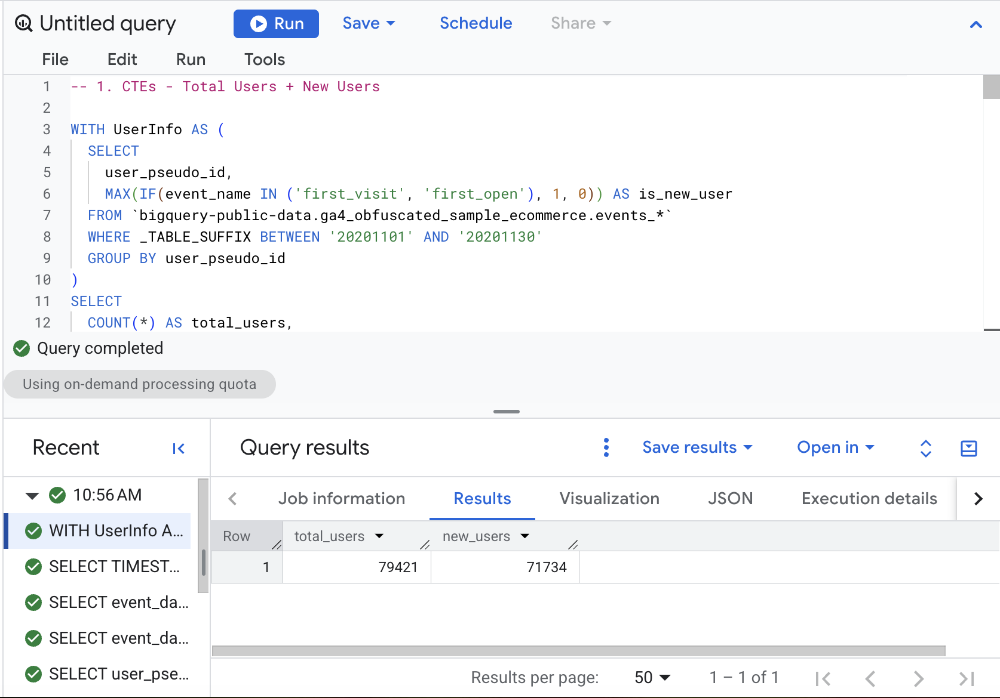
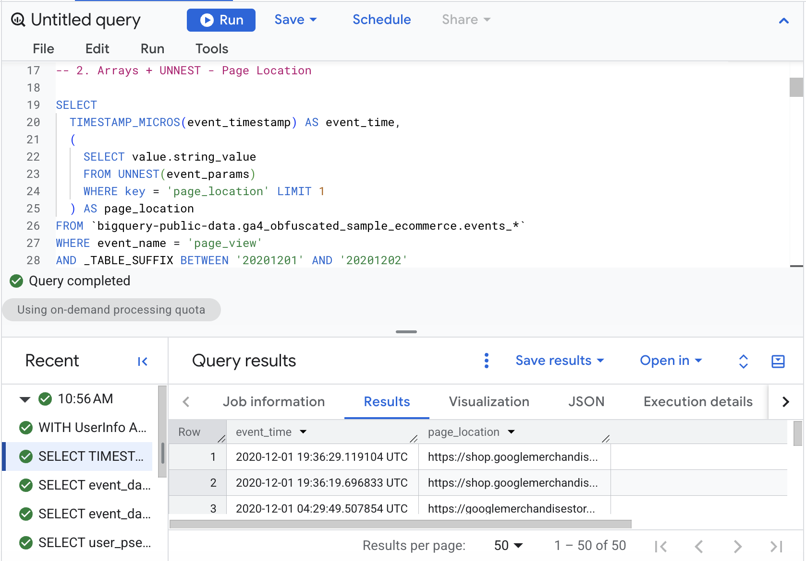
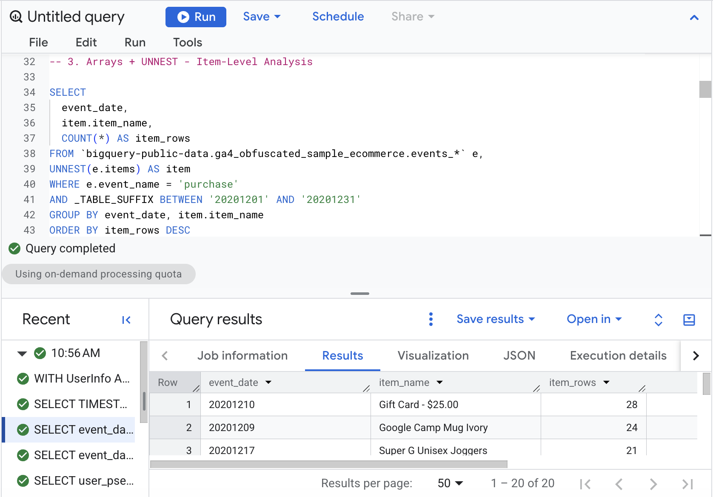
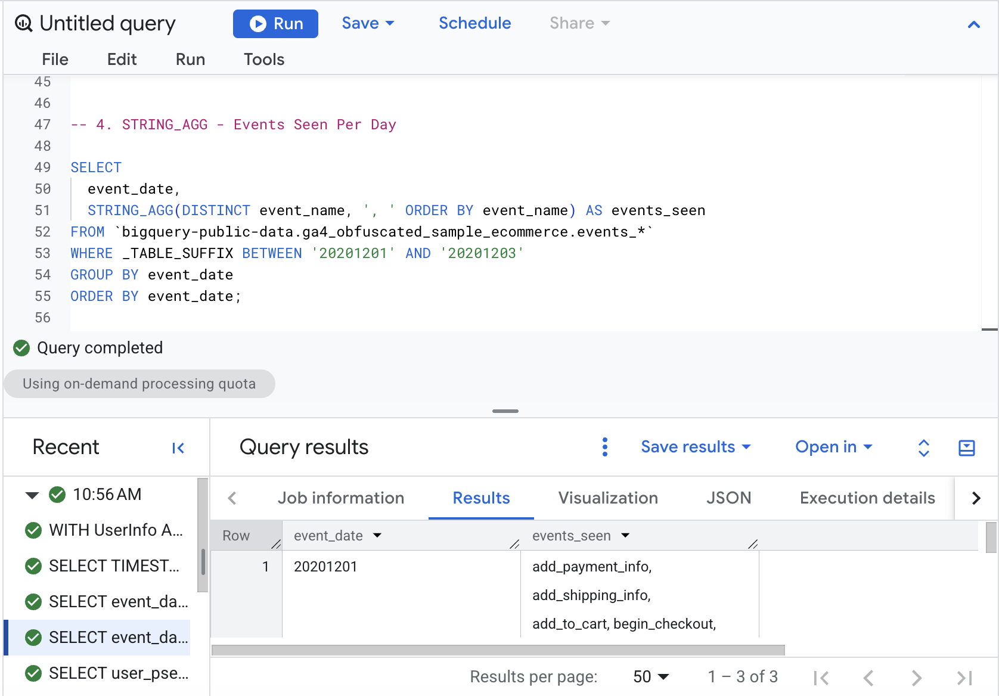
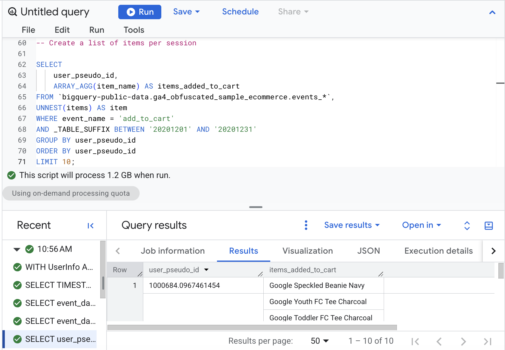
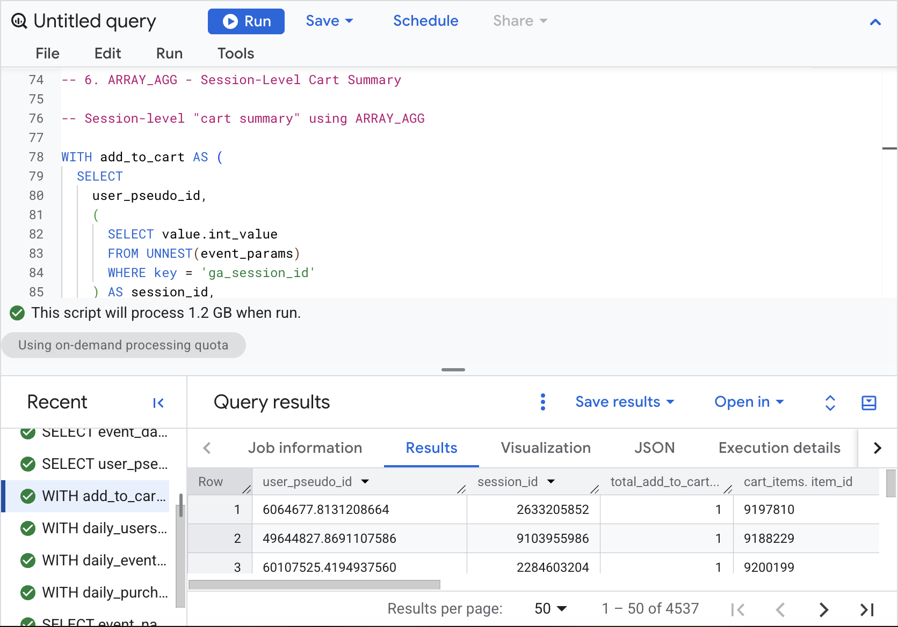
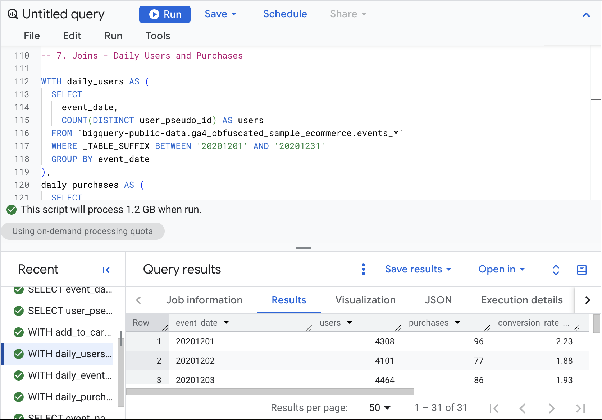
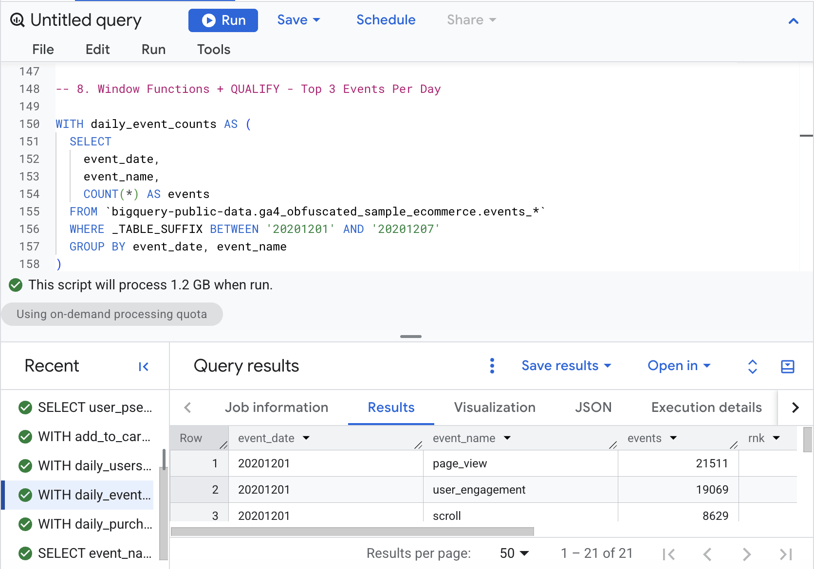
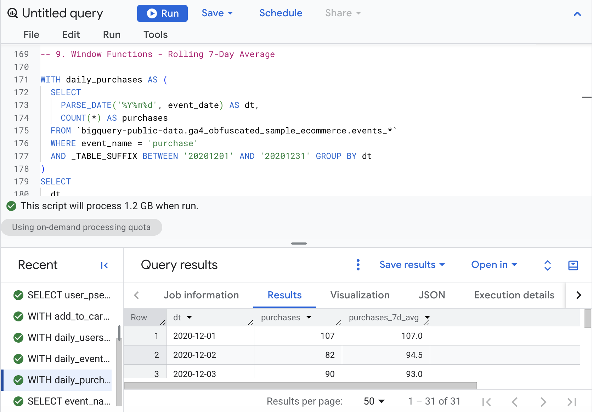
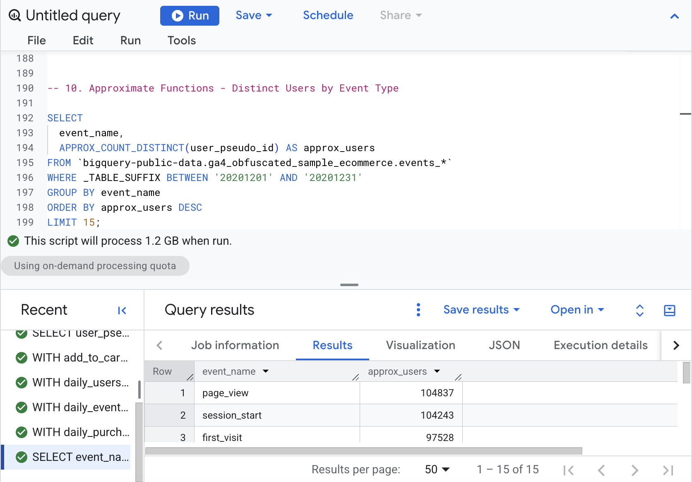

# Introduction

For this lecture, I ran each provided query in BigQuery and added its output below to see what the results actually show.

# CTEs (WITH)

## 1. CTEs (WITH) — Total Users and New Users

This uses a CTE to first identify which users had a `first_visit` or `first_open` event. It then counts the total users and how many of those were new during November 2020.

``` sql
WITH UserInfo AS (
  SELECT
    user_pseudo_id,
    MAX(IF(event_name IN ('first_visit', 'first_open'), 1, 0)) AS is_new_user
  FROM `bigquery-public-data.ga4_obfuscated_sample_ecommerce.events_*`
  WHERE _TABLE_SUFFIX BETWEEN '20201101' AND '20201130'
  GROUP BY user_pseudo_id
)
SELECT
  COUNT(*) AS total_users,
  SUM(is_new_user) AS new_users
FROM UserInfo;
```

**BigQuery output:**



# Arrays + UNNEST

## 2. Arrays + UNNEST — Page Location

Here, I use `UNNEST` inside a subquery to pull the page URL from `event_params`. It only looks at page views and returns up to 50 rows without splitting each event into multiple rows.

``` sql
SELECT
  TIMESTAMP_MICROS(event_timestamp) AS event_time,
  (
    SELECT value.string_value
    FROM UNNEST(event_params)
    WHERE key = 'page_location' LIMIT 1
  ) AS page_location
FROM `bigquery-public-data.ga4_obfuscated_sample_ecommerce.events_*`
WHERE event_name = 'page_view'
  AND _TABLE_SUFFIX BETWEEN '20201201' AND '20201202'
LIMIT 50;
```

**BigQuery output:**



## 3. Arrays + UNNEST — Purchase Items

This one expands the `items` array so I can look at individual products in purchase events. It shows the products with the most item rows, not necessarily the most units sold, since a row can have a quantity greater than one.

``` sql
SELECT
  event_date,
  item.item_name,
  COUNT(*) AS item_rows
FROM `bigquery-public-data.ga4_obfuscated_sample_ecommerce.events_*` e,
UNNEST(e.items) AS item
WHERE e.event_name = 'purchase'
  AND _TABLE_SUFFIX BETWEEN '20201201' AND '20201231'
GROUP BY event_date, item.item_name
ORDER BY item_rows DESC
LIMIT 20;
```

**BigQuery output:**



# STRING_AGG and ARRAY_AGG

## 4. STRING_AGG — Events Seen Each Day

This combines the different event names from each day into one list, so I can see which kinds of activity happened on each date. The lecture has a typo (`RDER BY`), so I had to change it to `ORDER BY` in BigQuery before running.

``` sql
SELECT
  event_date,
  STRING_AGG(DISTINCT event_name, ', ' ORDER BY event_name) AS events_seen
FROM `bigquery-public-data.ga4_obfuscated_sample_ecommerce.events_*`
WHERE _TABLE_SUFFIX BETWEEN '20201201' AND '20201203'
GROUP BY event_date
RDER BY event_date;
```

**BigQuery output:**



## 5. ARRAY_AGG — Cart Items by User (Use Case 1)

I use `ARRAY_AGG` to put all the items each user added to their cart into one array. Even though the lecture calls this a session list, this version only groups by `user_pseudo_id`, so it is really a user-level summary.

``` sql
-- Task: Create a list of items per session
SELECT
    user_pseudo_id,
    ARRAY_AGG(item_name) AS items_added_to_cart
FROM `bigquery-public-data.ga4_obfuscated_sample_ecommerce.events_*`,
UNNEST(items) AS item
WHERE event_name = 'add_to_cart'
AND _TABLE_SUFFIX BETWEEN '20201201' AND '20201231'
GROUP BY user_pseudo_id
ORDER BY user_pseudo_id
LIMIT 10;
```

**BigQuery output:**



## 6. ARRAY_AGG — Session Cart Summary (Use Case 2)

This version gets more specific by grouping cart activity by user and session. It keeps item details together in a `STRUCT` and lists up to 10 cart item rows for each session, with higher quantities first. The count is of unnested item rows, not necessarily distinct add-to-cart events.

``` sql
-- Session-level "cart summary" using ARRAY_AGG
WITH add_to_cart AS (
  SELECT
    user_pseudo_id,
    (
      SELECT value.int_value
      FROM UNNEST(event_params)
      WHERE key = 'ga_session_id'
    ) AS session_id,
    TIMESTAMP_MICROS(event_timestamp) AS event_timestamp,
    i.item_id,
    i.item_name,
    i.quantity,
    i.price
  FROM `bigquery-public-data.ga4_obfuscated_sample_ecommerce.events_*`,
  UNNEST(items) AS i
  WHERE event_name = 'add_to_cart'
    AND _TABLE_SUFFIX BETWEEN '20210101' AND '20211231'  -- cost control
)
SELECT
  user_pseudo_id,
  session_id,
  COUNT(*) AS total_add_to_cart_events,              -- added insight
  ARRAY_AGG(
    STRUCT(item_id, item_name, quantity, price, event_timestamp)
    ORDER BY quantity DESC, event_timestamp ASC
    LIMIT 10
  ) AS cart_items
FROM add_to_cart
WHERE session_id IS NOT NULL                          --  filter nulls
GROUP BY user_pseudo_id, session_id;
```

**BigQuery output:**



# Joins

## 7. LEFT JOIN — Daily Users and Purchases

I first create separate daily totals for users and purchases, then join them by date. `LEFT JOIN` keeps days without a purchase, and `IFNULL` displays 0 instead of a blank. The last column is transactions per daily user as a percentage, which is not exactly the percentage of users who purchased.

``` sql
WITH daily_users AS (
  SELECT
    event_date,
    COUNT(DISTINCT user_pseudo_id) AS users
  FROM `bigquery-public-data.ga4_obfuscated_sample_ecommerce.events_*`
  WHERE _TABLE_SUFFIX BETWEEN '20201201' AND '20201231'
  GROUP BY event_date
),
daily_purchases AS (
  SELECT
    event_date,
    COUNT(DISTINCT
      (SELECT value.string_value
       FROM UNNEST(event_params)
       WHERE key = 'transaction_id')
    ) AS purchases    -- distinct transactions
  FROM `bigquery-public-data.ga4_obfuscated_sample_ecommerce.events_*`
  WHERE event_name = 'purchase'
    AND _TABLE_SUFFIX BETWEEN '20201201' AND '20201231'
  GROUP BY event_date
)
SELECT
  u.event_date,
  u.users,
  -- turns “no purchase row (NULL)” into 0 purchases, which is what you want for a daily time series
  IFNULL(p.purchases, 0) AS purchases,
  -- Conversion rate: what % of daily users made a purchase
  ROUND(
    IFNULL(p.purchases, 0) / NULLIF(u.users, 0) * 100, 2
  ) AS conversion_rate_pct        -- NULLIF prevents division by zero
FROM daily_users u
LEFT JOIN daily_purchases p
  ON u.event_date = p.event_date
ORDER BY u.event_date;
```

**BigQuery output:**



# Window Functions + QUALIFY

## 8. Window Functions + QUALIFY — Top 3 Events Per Day

This ranks event types by how often they happened on each day. `QUALIFY` filters the ranking to the top three ranks per day. Ties can mean there are more than three rows for a date.

``` sql
WITH daily_event_counts AS (
  SELECT
    event_date,
    event_name,
    COUNT(*) AS events
  FROM `bigquery-public-data.ga4_obfuscated_sample_ecommerce.events_*`
  WHERE _TABLE_SUFFIX BETWEEN '20201201' AND '20201207'
  GROUP BY event_date, event_name
)
SELECT
  event_date,
  event_name,
  events,
  RANK() OVER (PARTITION BY event_date ORDER BY events DESC) AS rnk
FROM daily_event_counts
QUALIFY rnk <= 3
ORDER BY event_date, rnk;
```

**BigQuery output:**



## 9. Window Functions — Rolling 7-Day Average

This calculates purchases for each date and then averages the current row with the previous six rows. It makes the daily trend easier to follow, although days with zero purchases are missing unless the data has a purchase row for that date.

``` sql
WITH daily_purchases AS (
  SELECT
    PARSE_DATE('%Y%m%d', event_date) AS dt,
    COUNT(*) AS purchases
  FROM `bigquery-public-data.ga4_obfuscated_sample_ecommerce.events_*`
  WHERE event_name = 'purchase'
    AND _TABLE_SUFFIX BETWEEN '20201201' AND '20201231' GROUP BY dt
)
SELECT
  dt,
  purchases,
  AVG(purchases) OVER (
    ORDER BY dt
    ROWS BETWEEN 6 PRECEDING AND CURRENT ROW
  ) AS purchases_7d_avg
FROM daily_purchases
ORDER BY dt;
```

**BigQuery output:**



# Approximate Functions

## 10. Approximate Functions — Users by Event Type

This estimates the number of unique users for each event type rather than calculating an exact count. It can be faster on large datasets and shows the 15 event types with the highest estimated user counts.

``` sql
SELECT
  event_name,
  APPROX_COUNT_DISTINCT(user_pseudo_id) AS approx_users
FROM `bigquery-public-data.ga4_obfuscated_sample_ecommerce.events_*`
WHERE _TABLE_SUFFIX BETWEEN '20201201' AND '20201231'
GROUP BY event_name
ORDER BY approx_users DESC
LIMIT 15;
```

**BigQuery output:**



# Reflection

The biggest difference from Lecture 1 is that these queries do more than just filter and count rows. CTEs helped break up longer queries, `UNNEST` let me work with the GA4 arrays, and window functions made it possible to compare results across days. I also had to pay attention to what each row actually represents, especially after unnesting items.

# Appendix

- [Published report on GitHub Pages](https://itsnik1.github.io/bigquery-lecture-2/)
- [GitHub repository](https://github.com/itsnik1/bigquery-lecture-2)
